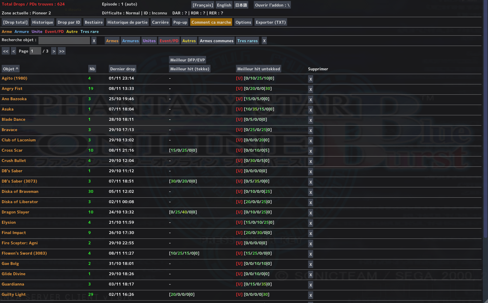

# HUNTER'S LOG

**A drop tracker and hunting journal for PSO Ephinea.**

Hunter's Log tracks rare drops and keeps a detailed record of your hunts, kills, games and statistics.

- **Author:** Akhyrion
- **Version:** 1.0
- **Languages:** French, English and Japanese. Switch languages with the **Français / English / 日本語** buttons; your choice is saved.

## Features

- **Drop counters:** counts rare items and Photon Drops, per item and in total. Tekking a weapon does not count it twice.
- **Drop history:** date, item, weapon stats (`[X/X/X/X|X]`), difficulty, area, section ID, monster, kills before the drop and more. Includes search, sorting, favorites and pagination.
- **Drops by section ID:** groups drops by section ID, with search.
- **Bestiary:** kills and drops per monster and area, with search.
- **Game history:** records recent games, including the quest played, section ID and drops obtained during the quest.
- **Career statistics:** lifetime records such as best hit percentages, most-killed monsters, most-played quests, and kills by difficulty and section ID.
- **Kill counter window:** displays kills in the current area and session kills.
- **Drop notifications:** on-screen notifications for drops, with icons, colors and configurable text outline.
- **Very rare filter:** customizable filter, plus support for counting common weapons only when they meet a minimum hit percentage.
- **Export and backups:** export statistics to a text file and automatically back up addon data.
- **Appearance and controls:** themes, adjustable opacity and an assignable hotkey to open or close the addon.

## Requirements

## Requirements

To use Hunter's Log you need three things:

1. **The addon plugin for PSOBB** (the system that lets the game load addons).
   Download it from [Solybum/psobbaddonplugin](https://github.com/Solybum/psobbaddonplugin) (see its [Releases](https://github.com/Solybum/psobbaddonplugin/releases) page) and follow the installation instructions in that repository. If your PSO Ephinea installation already has the addon system working (for example, if other addons already appear in your addon list), you can skip this step.

2. **Microsoft Visual C++ Redistributable for Visual Studio 2015**, required by the addon plugin.
   Download: [Visual C++ Redistributable for Visual Studio 2015](https://www.microsoft.com/en-us/download/details.aspx?id=48145).

3. **The `solylib` library**, required by Hunter's Log.
   Download it from [Solybum/PSOBBMod-Addons](https://github.com/Solybum/PSOBBMod-Addons) (**Code → Download ZIP**), then copy the **`solylib`** folder into your game's `addons` folder.
   If you already use addons such as Item Reader, you most likely already have `solylib`.

## Installation

1. Open the [Releases](../../releases) page and download the latest Hunter's Log release.
2. Extract the downloaded archive.
3. Copy the **`Hunters Log`** folder into your game's `addons` folder. The resulting path should look like this:

   ```text
   ...\addons\Hunters Log\
   ```

   Keep the folder name exactly as **`Hunters Log`**.
4. Start the game and enable **Hunter's Log** in the addon list.
5. Open the addon using the **Hunter's Log** button in the main menu, or use your configured hotkey.

## Repository structure

The GitHub repository is organized like this. The README is at the repository root; the `Hunters Log/` folder is the addon folder players install.

```text
Hunter's Log/
├── README.md             Project presentation (GitHub)
└── Hunters Log/           Addon folder to install
    ├── init.lua           Main addon file
    ├── charts/            Drop rates, enemy and quest data
    ├── data/              Static data and translations
    ├── modules/           Addon modules
    └── LICENSE.txt        MIT license for the addon code
```

The downloadable release should contain the **`Hunters Log/`** addon folder, so players can copy it directly into their game's `addons` directory. The GitHub `README.md` is documentation for the repository and does not need to be placed inside the game's addon folder.

## Your data and updates

Hunter's Log creates its data files and folders automatically when needed. You do not need to create them manually.

Examples of files and folders created by the addon:

- `data.lua` — counters, history and settings.
- `career.lua` — career records and statistics.
- `game_history/` — game history.
- `save/` — automatic backups and backups made before a reset.
- `exports/` — text exports, such as `item_stats_export.txt`.

**When updating:** keep your personal data. Replace the addon's program files and bundled data (`init.lua`, `charts/`, `data/` and `modules/`) with the files from the new release, but do not overwrite or delete your generated data files and folders. If in doubt, make a copy of your entire `Hunters Log` folder before updating.

## Troubleshooting and bug reports

If the addon does not load or something does not work as expected:

1. Check that the folder is named exactly `Hunters Log` and is inside the game's `addons` folder.
2. Check that the Ephinea addon system is enabled and that `solylib` is available.
3. Make a backup of your `Hunters Log` folder before trying a reinstall or changing data files.
4. When reporting a bug, include:
   - the Hunter's Log version;
   - what you were doing;
   - what you expected to happen;
   - what happened instead;
   - any relevant error message.

Please do not share personal save files or private information in a public bug report. If a save file is needed to investigate an issue, contact the author first.

## Credits and data

- Drop rates and enemy data are based on the Ephinea drop chart.
- Hunter's Log is built on `solylib` for the Ephinea addon system.

## License and disclaimer

The addon code is licensed under the **MIT License**; see [`LICENSE`](LICENSE). The license applies to the addon code only.

The drop chart data in the `charts/` folder comes from Ephinea and is not covered by the addon code license. Please refer to Ephinea's terms and policies regarding the use and redistribution of that data.

Hunter's Log is a fan project and is not affiliated with, endorsed by, or sponsored by SEGA or Ephinea.


## Screenshots

### Total Drops

Track all your rare item drops and Photon Drops,
with detailed statistics, hit percentages and drop history.


